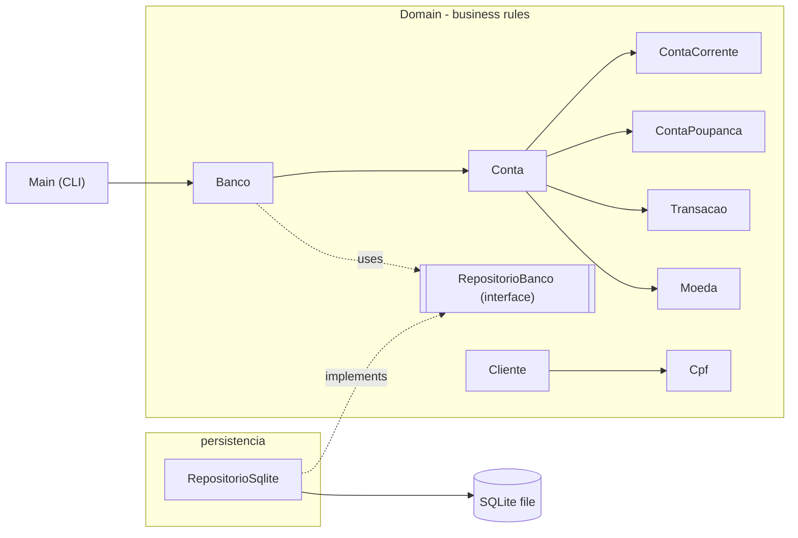

# Banking System in Java

[](https://github.com/Amandadamata/sistema-bancario-java/actions/workflows/ci.yml)

**English** · [Português (Brasil)](README.pt-BR.md)

A command-line banking application with checking and savings accounts, exact money arithmetic,
overdraft limits, transfers, a monthly savings yield, CPF validation, and SQLite persistence.
It is a Java fundamentals project focused on object-oriented design, business rules, data
consistency, and tests.

## Problem it solves

Banking rules are a good test of correctness: money must never be lost to rounding, a failed
transfer must leave both accounts unchanged, every movement must be traceable, and data must
survive a restart without ever being stored half-written. This project implements those rules in
plain Java and verifies them with automated tests.

## Features

- Open checking accounts (with an overdraft limit) and savings accounts
- Deposits, withdrawals, and transfers between accounts, including overdraft use
- Exact monetary values with `BigDecimal` (two decimal places, explicit rounding)
- Monthly savings yield of 0.5%, applied at most once per calendar month
- Statement with type, signed amount, resulting balance, timestamp, and related account
- CPF validation (format, length, repeated digits, check digits); one CPF per account holder
- Persistence in a local SQLite file: customers, accounts, balances, statements, and the yield month
  survive a restart
- Every operation is saved atomically; if saving fails, the operation is undone
- Brazilian number input and output (`100,50` or `100.50` in; `R$ 1.234,56` out)

## Technologies

| Technology | Why it is used |
|---|---|
| Java 17 (CI also on 21 and 25) | Language; LTS version with `record`, `switch` expressions and pattern matching |
| SQLite + JDBC (`org.xerial:sqlite-jdbc`) | Relational storage in a single file, no server to install, real SQL and ACID transactions |
| Maven + Maven Wrapper | Build, tests, and an executable JAR (Shade plugin) without installing Maven |
| JUnit 6 | Unit and integration tests |
| GitHub Actions + Dependabot | CI on every push and pull request; monthly dependency updates |

## Architecture



| Class | Responsibility |
|---|---|
| `Banco` (Bank) | Single entry point: opens accounts, numbers them, runs operations and saves the result |
| `Conta`, `ContaCorrente`, `ContaPoupanca` | Balance, statement and rules; the overdraft is a polymorphic override |
| `Transacao` / `TipoTransacao` | Immutable statement entry and its credit/debit type |
| `Moeda` (Money) | Money parsing, validation, rounding, and `R$` formatting |
| `Cliente`, `Cpf` | Account holder; CPF value object with check-digit validation |
| `RepositorioBanco` | Storage contract defined by the domain |
| `persistencia.RepositorioSqlite` | JDBC implementation with SQL transactions |
| `Main` | Console menu only; no business rules |

Code identifiers are in Portuguese because the project models Brazilian banking terms.

Key design decisions (details in [docs/DESIGN_DECISIONS.md](docs/DESIGN_DECISIONS.md)):

- **`BigDecimal` in memory, integer cents in the database.** `double` and SQLite `REAL` are binary
  floating point (`0.1 + 0.2 = 0.30000000000000004`).
- **Capture, apply, save or undo.** `Banco` captures the state of the accounts involved, applies the
  rule, and saves all of them in one SQL transaction. If saving fails, the database rolls back and
  the accounts return to the captured state.
- **Data is checked when loaded.** Each statement is replayed and must match the stored balance;
  inconsistent or tampered data stops the program with a clear message.
- **The domain does not depend on SQLite.** `Banco` talks to the `RepositorioBanco` interface; rule
  tests use an in-memory repository that can fail on purpose.
- **CPF check digits, never the full number in messages.** Validation is mathematical only (see
  limitations).

## Project structure

```text
.
├── .github/                        # CI workflow (Java 17, 21, 25) and Dependabot
├── docs/                           # Architecture, design decisions, testing
├── src/main/java/com/github/amandadamata/sistemabancario/
│   ├── Banco.java, Conta.java, ContaCorrente.java, ContaPoupanca.java
│   ├── Cliente.java, Cpf.java, Moeda.java, Transacao.java, TipoTransacao.java
│   ├── RepositorioBanco.java, ContaPersistida.java, EstadoConta.java, TipoConta.java
│   ├── FalhaPersistenciaException.java, SaldoInsuficienteException.java
│   ├── Main.java
│   └── persistencia/RepositorioSqlite.java
├── src/test/java/...               # Unit, integration (SQLite) and CLI tests
├── mvnw, mvnw.cmd, .mvn/           # Maven Wrapper
└── pom.xml
```

## Prerequisites

- JDK 17 or newer (`java -version`)
- Internet access on the first build, so the Maven Wrapper can download Maven and dependencies

## Build and run (macOS / Linux)

```bash
git clone https://github.com/Amandadamata/sistema-bancario-java.git
cd sistema-bancario-java
./mvnw clean package
java -jar target/sistema-bancario-java-1.1.0.jar
```

On Windows, use `mvnw.cmd` instead of `./mvnw`.

Data is stored in `dados/sistema-bancario.db`, relative to the folder where you run the command.
To use another file, for example for a demo:

```bash
SISTEMA_BANCARIO_DB=/tmp/bank-demo.db java -jar target/sistema-bancario-java-1.1.0.jar
```

To start from scratch, delete the database file. The `dados/` folder and `*.db` files are ignored by
Git.

## Usage example

Real output from the packaged application, run twice on the same database (menu lines omitted).
In the first run, account 1000 (savings) receives a deposit, sends a transfer, and earns its yield.
The second run shows the data restored and the monthly rule still enforced:

```text
Nº 1000 | Conta Poupança | Titular: Ana Souza            | Saldo: R$ 853,75
Nº 1001 | Conta Corrente | Titular: Bruno Lima           | Saldo: R$ 150,50
[21/10/2026 11:12:45] Depósito                                   +R$ 1.000,00 | Saldo após: R$ 1.000,00
[21/10/2026 11:12:45] Transferência enviada (para a conta 1001)  -R$ 150,50 | Saldo após: R$ 849,50
[21/10/2026 11:12:45] Rendimento                                 +R$ 4,25 | Saldo após: R$ 853,75
Saldo atual: R$ 853,75
Erro: O rendimento de 10/2026 já foi aplicado a esta conta.
```

The user interface is in Portuguese.

## Tests

```bash
./mvnw test
```

The suite covers money arithmetic, every rejected operation leaving data unchanged, overdraft,
transfers, statement contents, the monthly yield, CPF validation, numbering, and full menu
sessions. Integration tests use a real SQLite file to check restart round trips, a transfer
interrupted in the middle of the SQL transaction, tampered balances, unreadable files, and newer
schema versions. See [docs/TESTING.md](docs/TESTING.md).

## Continuous integration

GitHub Actions runs `./mvnw --batch-mode verify` on Java 17, 21, and 25 for every push and pull
request to `main`, with read-only repository permissions.

## Security and privacy

- The database contains names and CPFs. It is a local file, ignored by Git (`dados/`, `*.db`), and
  it is not encrypted.
- Error messages and `toString()` never show a full CPF.
- Tests and examples use synthetic CPFs generated by the algorithm.
- SQL commands use `PreparedStatement` parameters, never string concatenation of user input.

## Known limitations

- CPF validation is mathematical only. It does not prove identity, ownership, or registration
  status with the Brazilian Federal Revenue (Receita Federal).
- The savings yield is an educational rule (0.5% per calendar month on the current balance); it does
  not reproduce the official Brazilian savings rule (anniversary date, TR, Selic).
- No overdraft interest or fees, no authentication, no account closing.
- One process at a time: two copies of the program on the same file are not coordinated.
- The database file is not encrypted.

## Possible next steps

- Account closing with rules for remaining balances
- Database migrations if the schema changes (the version is already stored in `PRAGMA user_version`)

## Documentation

- [Architecture](docs/ARCHITECTURE.md): diagrams, responsibilities, database schema, execution flow
- [Design decisions](docs/DESIGN_DECISIONS.md): what was chosen, why, alternatives, and the tests that verify it
- [Testing](docs/TESTING.md): how to run tests, what each class verifies, coverage

## License

[MIT](LICENSE)
