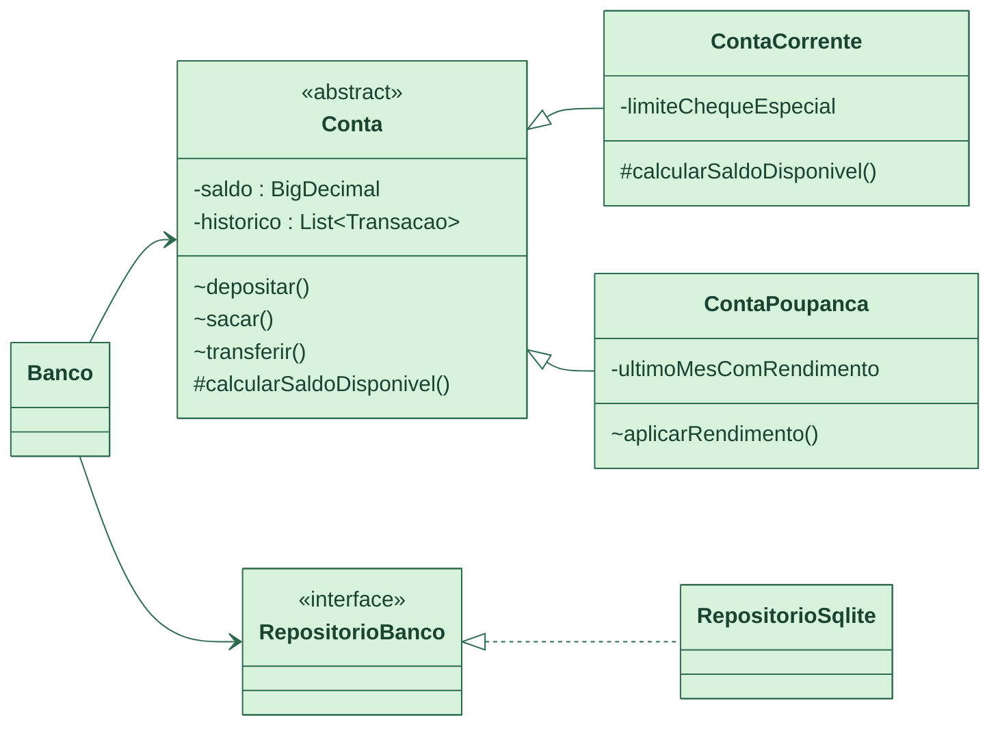

**English** · [Português](README.pt-BR.md)

[](https://github.com/Amandadamata/sistema-bancario-java/actions/workflows/ci.yml)


[](LICENSE)

A Java 17 command-line banking app with checking and savings accounts, backed by SQLite.

## The problem

A checking account can go into overdraft up to a limit. A savings account can't, but it earns interest, and only once a month. A transfer has to fail cleanly when there isn't enough money, without leaving either account half-updated. The math also has to be exact, and in Java `0.1 + 0.2` with `double` gives `0.30000000000000004`.

## The solution

This app models those rules in plain Java. You open accounts, deposit, withdraw, transfer and check a statement from a menu in the terminal. Amounts use `BigDecimal`, so every cent is exact. Each operation is saved to a SQLite file in a single SQL transaction: either everything is stored, or nothing is, and the account in memory goes back to how it was.

## Demo


*Account 1000 is a checking account with a R$ 200 overdraft limit. It gets R$ 100, then pays R$ 250 using the overdraft. A further R$ 100 is refused, because only R$ 50 is left. The R$ 50 transfer goes through, and the statement shows every movement with the balance after it. (The app's interface is in Portuguese.)*

## Features

- Checking accounts with an overdraft limit, and savings accounts.
- Deposits, withdrawals and transfers between accounts.
- Monthly savings interest of 0.5%, applied at most once per calendar month.
- Statement with type, signed amount, resulting balance, date and the other account in a transfer.
- CPF (Brazilian tax ID) check-digit validation, with one CPF per account holder.
- Data saved in SQLite, so accounts and statements survive a restart.
- Brazilian number format: you can type `100,50` or `100.50`, and you see `R$ 1.234,56`.

## What this project shows

| Skill | Where / how it shows up |
|---|---|
| Abstraction | `Conta` is an `abstract` class that holds the balance, the statement and the shared rules. `RepositorioBanco` is an interface, so `Banco` doesn't know SQLite exists. |
| Inheritance | `ContaCorrente` and `ContaPoupanca` extend `Conta`. The savings account adds `aplicarRendimento()`, which remembers the last month it paid interest. |
| Polymorphism | `ContaCorrente` overrides `calcularSaldoDisponivel()` to add the overdraft limit. `Conta` checks the available balance without asking which type of account it is. |
| Encapsulation | There's no `setSaldo`. The balance only changes through operations that also write a statement line, and `getHistorico()` returns a copy with `List.copyOf`. |
| Custom exceptions | `SaldoInsuficienteException` is thrown by `Conta` when a withdrawal or transfer goes over the available balance. `FalhaPersistenciaException` reports a failed save. |
| SQL and transactions | `RepositorioSqlite` turns off auto-commit, saves every account involved, then calls `commit()` or `rollback()`. Queries use `PreparedStatement`, and foreign keys are switched on. |
| Parameterized tests | 13 `@ParameterizedTest` methods. For example, `ContaTest` sends `0`, `-10.00`, `0.001`, `10.005` and `null` to every operation and checks that all are refused and no balance changes. |
| Automated tests and CI | 135 JUnit 6 tests in 9 classes, including integration tests with a real SQLite file. [`ci.yml`](.github/workflows/ci.yml) runs them on Java 17, 21 and 25 for every push and pull request. |

## How it works



`Main` only shows the menu and reads what you type. Every action goes through `Banco`, which follows the same three steps each time. First it takes a snapshot of the accounts involved. Then it asks the account to apply the rule: `Conta` checks the amount, asks `calcularSaldoDisponivel()` how much can be spent, and throws `SaldoInsuficienteException` if it's not enough. Last, it saves everything in one SQL transaction, and if the save fails, the accounts go back to the snapshot. When the app starts, it replays each statement and checks that it adds up to the stored balance.

## Technical decisions

- **I chose `BigDecimal` instead of `double`** because `double` can't store most decimal values exactly. In the database, money is stored as whole cents (`INTEGER`) for the same reason.
- **I chose SQLite instead of a database server** because it's a single file with real SQL and transactions, and nothing extra to install to run the project.
- **I chose to make the overdraft an override instead of an `if` on the account type.** Adding a new kind of account means writing a new class, not editing the rules in `Conta`.
- **I chose a checked exception for insufficient balance** because it's an expected situation, and the compiler forces the menu to handle it with a clear message.

More details and the alternatives I considered are in [DESIGN_DECISIONS.md](docs/DESIGN_DECISIONS.md).

## Running it

You need Java 17 or newer. The first build downloads Maven and the dependencies through the Maven Wrapper. I built it in IntelliJ IDEA, but any terminal works.

```bash
git clone https://github.com/Amandadamata/sistema-bancario-java.git
cd sistema-bancario-java
./mvnw clean package
java -jar target/sistema-bancario-java-1.1.0.jar
```

```bash
./mvnw test
```

On Windows, use `mvnw.cmd`. Data goes to `dados/sistema-bancario.db`. To use another file, set `SISTEMA_BANCARIO_DB=/tmp/bank-demo.db`. The demo GIF can be recorded again with [VHS](https://github.com/charmbracelet/vhs): `vhs docs/assets/demo.tape`.

## Project structure

```text
src/main/java/com/github/amandadamata/sistemabancario/
├── Banco.java                  # entry point for every operation; snapshot, apply, save or undo
├── Conta.java                  # abstract account: balance, statement, shared rules
├── ContaCorrente.java          # overdraft
├── ContaPoupanca.java          # monthly interest
├── Cliente.java, Cpf.java      # account holder and CPF validation
├── Moeda.java, Transacao.java  # money parsing/formatting and statement entries
├── RepositorioBanco.java       # storage contract
├── persistencia/RepositorioSqlite.java  # JDBC + SQL transactions
└── Main.java                   # console menu only
src/test/                       # 135 tests: unit, SQLite integration and menu sessions
docs/                           # architecture, design decisions, testing
```

Class and method names are in Portuguese because the project uses Brazilian banking terms.

## Limits and what's next

What it doesn't do yet:

- CPF validation is mathematical only. It doesn't prove anyone's identity.
- The 0.5% interest is a simplified rule, not the official Brazilian savings formula.
- No login, overdraft fees or account closing. One process uses the database at a time, and the file isn't encrypted.

Next steps I'm planning:

- Expose the accounts through a REST API with Spring Boot, which I'm studying now.
- Account closing, with rules for any balance left.
- Schema migrations (the version is already stored in `PRAGMA user_version`).

## Author

**Amanda da Mata** · Back-End developer in training · Java and Python  
[LinkedIn](https://www.linkedin.com/in/amanda-da-mata-492106288) · [amandadamataprofissional@gmail.com](mailto:amandadamataprofissional@gmail.com) · [GitHub](https://github.com/Amandadamata)
