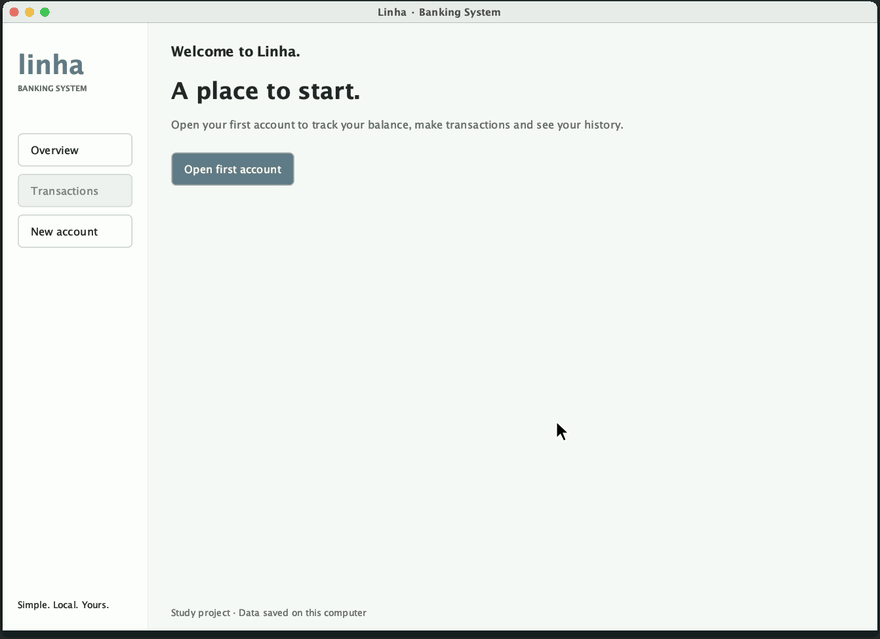
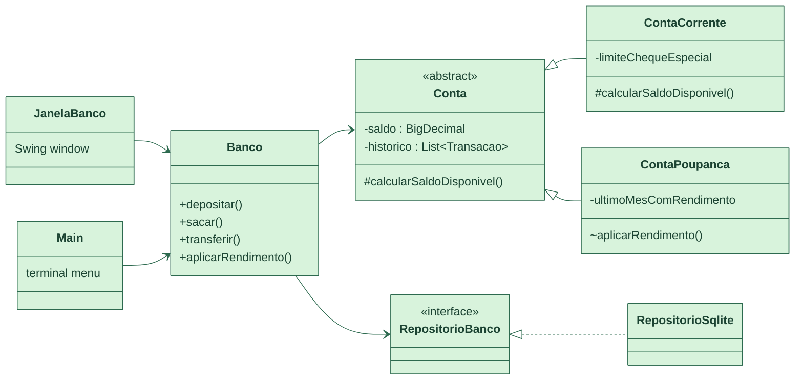

**English** · [Português](README.pt-BR.md)

[](https://github.com/Amandadamata/sistema-bancario-java/actions/workflows/ci.yml)


[](LICENSE)

A Java 17 banking app with checking and savings accounts, backed by SQLite. It has two interfaces over the same business rules: **Linha**, a desktop app in Swing, and the original terminal menu.

It's a study project. Operations change local balances only, and no real money moves.

## The problem

A checking account can go into overdraft up to a limit. A savings account can't, but it earns interest, and only once a month. A transfer has to fail cleanly when there isn't enough money, without leaving either account half-updated. The math also has to be exact, and in Java `0.1 + 0.2` with `double` gives `0.30000000000000004`.

## The solution

This app models those rules in plain Java. You open accounts, deposit, withdraw, transfer and check a statement, in a window or in the terminal. Amounts use `BigDecimal`, so every cent is exact. Each operation is saved to a SQLite file in a single SQL transaction: either everything is stored, or nothing is, and the account in memory goes back to how it was.

Adding the desktop interface didn't change any of the original domain, persistence or menu classes. Both interfaces call `Banco`, and no financial class imports Swing.

## Demo

### Desktop interface



*The window, clicks and data are real, on a temporary SQLite file. Frames are painted by the Swing components themselves; the title bar, pointer and captions are drawn by [the recording script](scripts/demo/GravarDemoInterface.java).*

### Terminal


*Account 1000 has a R$ 200 overdraft limit. It gets R$ 100, then pays R$ 250 using the overdraft. A further R$ 100 is refused, because only R$ 50 is left. After closing and reopening, the balances are still there. (The app's interface is in Portuguese.)*

## Features

- Checking accounts with an overdraft limit, and savings accounts.
- Deposits, withdrawals and transfers between accounts.
- Monthly savings interest of 0.5%, applied at most once per calendar month.
- Statement with date, type, signed amount, resulting balance and the other account in a transfer.
- CPF (Brazilian tax ID) check-digit validation, with one CPF per account holder.
- Data saved in SQLite, so accounts and statements survive a restart.
- Brazilian number format: you can type `100,50` or `100.50`, and you see `R$ 1.234,56`.
- In the desktop app: errors keep the form filled in, saving runs in the background so the window never freezes, and a double click can't submit twice.

## What this project shows

| Skill | Where / how it shows up |
|---|---|
| Abstraction | `Conta` is an `abstract` class that holds the balance, the statement and the shared rules. `RepositorioBanco` is an interface, so `Banco` doesn't know SQLite exists. |
| Inheritance | `ContaCorrente` and `ContaPoupanca` extend `Conta`. The savings account adds `aplicarRendimento()`, which remembers the last month it paid interest. |
| Polymorphism | `ContaCorrente` overrides `calcularSaldoDisponivel()` to add the overdraft limit. `Conta` checks the available balance without asking which type of account it is. |
| Encapsulation | There's no `setSaldo`. The balance only changes through operations that also write a statement line, and `getHistorico()` returns a copy with `List.copyOf`. |
| Separated layers | Two interfaces share one domain. The `ui` package only reaches accounts through `Banco`, and the desktop app was added without editing a single financial rule. |
| Concurrency in a GUI | `TarefasUi` runs each save in a `SwingWorker`, off the event thread, one at a time. Controls stay disabled and closing the window waits until it finishes. |
| Custom exceptions | `SaldoInsuficienteException` is thrown by `Conta` when a withdrawal or transfer goes over the available balance. `FalhaPersistenciaException` reports a failed save. |
| SQL and transactions | `RepositorioSqlite` turns off auto-commit, saves every account involved, then calls `commit()` or `rollback()`. Queries use `PreparedStatement`, and foreign keys are switched on. |
| Parameterized tests | 13 `@ParameterizedTest` methods. For example, `ContaTest` sends `0`, `-10.00`, `0.001`, `10.005` and `null` to every operation and checks that all are refused and no balance changes. |
| Automated tests and CI | 151 JUnit 6 tests in 13 classes, including a real SQLite file and real Swing windows. [`ci.yml`](.github/workflows/ci.yml) runs them on Java 17, 21 and 25 (the Swing flows on 17, on a virtual display) and starts the packaged JAR. |

## How it works



Every action goes through `Banco`, which follows the same three steps each time. First it takes a snapshot of the accounts involved. Then it asks the account to apply the rule: `Conta` checks the amount, asks `calcularSaldoDisponivel()` how much can be spent, and throws `SaldoInsuficienteException` if it's not enough. Last, it saves everything in one SQL transaction, and if the save fails, the accounts go back to the snapshot. When the app starts, it replays each statement and checks that it adds up to the stored balance.

More in [ARCHITECTURE.md](docs/ARCHITECTURE.md).

## Technical decisions

- **I chose `BigDecimal` instead of `double`** because `double` can't store most decimal values exactly. In the database, money is stored as whole cents (`INTEGER`) for the same reason.
- **I chose SQLite instead of a database server** because it's a single file with real SQL and transactions, and nothing extra to install to run the project.
- **I chose to make the overdraft an override instead of an `if` on the account type.** Adding a new kind of account means writing a new class, not editing the rules in `Conta`.
- **I chose a checked exception for insufficient balance** because it's an expected situation, and the compiler forces each interface to handle it with a clear message.
- **I chose Swing with FlatLaf instead of a web front end** because it ships in one JAR with the existing Java classes, with no server or browser involved.

More details and the alternatives I considered are in [DESIGN_DECISIONS.md](docs/DESIGN_DECISIONS.md).

## Running it

### Download

| Package | What you need | How to open |
|---|---|---|
| [`Linha-JAR-portatil.zip`](https://github.com/Amandadamata/sistema-bancario-java/releases/latest/download/Linha-JAR-portatil.zip) | Java 17 or newer, on any system | `java -jar Linha.jar` for the window, or `java -jar Linha.jar --terminal` for the menu |
| [`Linha-Mac-AppleSilicon.zip`](https://github.com/Amandadamata/sistema-bancario-java/releases/latest/download/Linha-Mac-AppleSilicon.zip) | A Mac with Apple Silicon; Java is included | Unzip and open `Linha.app` |

The Mac app isn't signed with an Apple developer certificate, so macOS blocks it the first time. To allow it, try to open it once, then go to **System Settings → Privacy & Security** and click **Open Anyway**.

### From the source code

You need Java 17 or newer. The first build downloads Maven and the dependencies through the Maven Wrapper.

```bash
git clone https://github.com/Amandadamata/sistema-bancario-java.git
cd sistema-bancario-java
./mvnw clean package
```

Open the desktop app:

```bash
java -jar target/sistema-bancario-java-1.2.0.jar
```

Open the terminal menu:

```bash
java -jar target/sistema-bancario-java-1.2.0.jar --terminal
```

On Windows, use `mvnw.cmd`. In IntelliJ IDEA, open the `pom.xml`, choose a JDK 17 or newer, and run `DesktopMain` (window) or `Main` (terminal).

To explore, use made-up data. This synthetic CPF passes the validation: `246.813.579-28`.

### Where the data goes

| Interface | Default file |
|---|---|
| Desktop on macOS | `~/Library/Application Support/Linha/sistema-bancario.db` |
| Desktop on other systems | `~/.linha/sistema-bancario.db` |
| Terminal | `dados/sistema-bancario.db`, relative to the current folder |

To use another file, set `SISTEMA_BANCARIO_DB=/tmp/bank-demo.db`. The `.db.lock` file next to the database stops a second desktop window from opening the same data, and it's normal for it to stay there after closing.

### Tests

```bash
./mvnw test                # domain, SQLite and presentation; skips the 8 Swing flows
./mvnw -Pui-tests verify   # all 151 tests; needs a graphical session
```

On Linux without a display: `xvfb-run -a ./mvnw -Pui-tests verify`. More in [TESTING.md](docs/TESTING.md).

### Packaging and demos

- `./scripts/package-macos.sh` builds `Linha.app` with `jpackage`, plus both ZIPs, on a Mac.
- `vhs docs/assets/demo.tape` records the terminal demo, using [VHS](https://github.com/charmbracelet/vhs).
- [`GravarDemoInterface.java`](scripts/demo/GravarDemoInterface.java) records the desktop demo.

## Project structure

```text
src/main/java/com/github/amandadamata/sistemabancario/
├── DesktopMain.java            # JAR entry point: opens the window, or the menu with --terminal
├── ArquivoAplicacao.java       # stable data path and lock between desktop instances
├── Banco.java                  # entry point for every operation; snapshot, apply, save or undo
├── Conta.java                  # abstract account: balance, statement, shared rules
├── ContaCorrente.java          # overdraft
├── ContaPoupanca.java          # monthly interest
├── Cliente.java, Cpf.java      # account holder and CPF validation
├── Moeda.java, Transacao.java  # money parsing/formatting and statement entries
├── RepositorioBanco.java       # storage contract
├── persistencia/RepositorioSqlite.java  # JDBC + SQL transactions
├── ui/                         # window, screens, theme and background tasks
└── Main.java                   # console menu only
src/test/                       # 151 tests: unit, SQLite integration, menu sessions and Swing flows
scripts/                        # macOS packaging and demo recording
docs/                           # architecture, design decisions, testing, evolution notes
```

Class and method names are in Portuguese because the project uses Brazilian banking terms.

## Limits and what's next

What it doesn't do yet:

- CPF validation is mathematical only. It doesn't prove anyone's identity.
- The 0.5% interest is a simplified rule, not the official Brazilian savings formula.
- No login, overdraft fees or account closing, and the file isn't encrypted. Choosing an account in the window is navigation, not access control.
- The file lock only covers desktop instances. Don't use the terminal and the window on the same file at the same time.
- Accounts and statements are loaded into memory, which suits a small amount of local data.

Next steps I'm planning:

- Expose the accounts through a REST API with Spring Boot, which I'm studying now.
- Account closing, with rules for any balance left.
- Statement export and pagination for longer histories.
- Schema migrations (the version is already stored in `PRAGMA user_version`).

## Author

**Amanda da Mata** · Back-End developer in training · Java and Python  
[LinkedIn](https://www.linkedin.com/in/amanda-da-mata-492106288) · [amandadamataprofissional@gmail.com](mailto:amandadamataprofissional@gmail.com) · [GitHub](https://github.com/Amandadamata)

MIT [license](LICENSE). The desktop theme uses [FlatLaf](https://www.formdev.com/flatlaf/), under the Apache 2.0 license.
