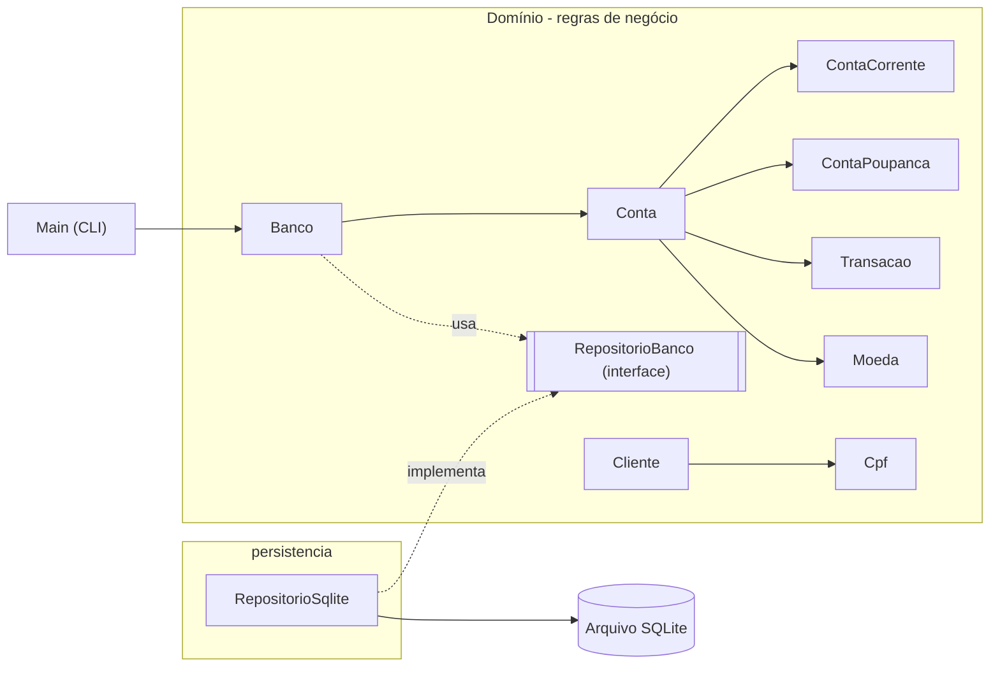

# Sistema Bancário em Java

[](https://github.com/Amandadamata/sistema-bancario-java/actions/workflows/ci.yml)

[English](README.md) · **Português (Brasil)**

Aplicação de linha de comando com contas corrente e poupança, aritmética monetária exata, cheque
especial, transferências, rendimento mensal da poupança, validação de CPF e persistência em
SQLite. É um projeto de fundamentos de Java focado em orientação a objetos, regras de negócio,
consistência de dados e testes.

## Problema resolvido

Regras bancárias são um bom teste de correção: dinheiro não pode se perder em arredondamentos, uma
transferência recusada precisa deixar as duas contas inalteradas, toda movimentação precisa ser
rastreável e os dados precisam sobreviver a um reinício sem nunca ficarem gravados pela metade.
Este projeto implementa essas regras em Java puro e as verifica com testes automatizados.

## Funcionalidades

- Abertura de contas corrente (com limite de cheque especial) e poupança
- Depósitos, saques e transferências entre contas, inclusive usando o cheque especial
- Valores monetários exatos com `BigDecimal` (duas casas decimais, arredondamento explícito)
- Rendimento mensal de 0,5% na poupança, aplicado no máximo uma vez por mês-calendário
- Extrato com tipo, valor com sinal, saldo resultante, data/hora e conta relacionada
- Validação de CPF (formato, tamanho, dígitos repetidos, dígitos verificadores); um CPF por titular
- Persistência em um arquivo SQLite local: clientes, contas, saldos, extratos e o mês do rendimento
  sobrevivem ao reinício
- Cada operação é gravada de forma atômica; se a gravação falhar, a operação é desfeita
- Entrada e saída no padrão brasileiro (`100,50` ou `100.50` na entrada; `R$ 1.234,56` na saída)

## Tecnologias

| Tecnologia | Por que é usada |
|---|---|
| Java 17 (CI também em 21 e 25) | Linguagem; versão LTS com `record`, `switch` com expressões e *pattern matching* |
| SQLite + JDBC (`org.xerial:sqlite-jdbc`) | Armazenamento relacional em um único arquivo, sem servidor, com SQL real e transações ACID |
| Maven + Maven Wrapper | Build, testes e JAR executável (plugin Shade) sem instalar o Maven |
| JUnit 6 | Testes de unidade e de integração |
| GitHub Actions + Dependabot | CI a cada push e pull request; atualizações mensais de dependências |

## Arquitetura



| Classe | Responsabilidade |
|---|---|
| `Banco` | Porta de entrada única: abre contas, numera, executa as operações e grava o resultado |
| `Conta`, `ContaCorrente`, `ContaPoupanca` | Saldo, extrato e regras; o cheque especial é uma sobrescrita polimórfica |
| `Transacao` / `TipoTransacao` | Lançamento imutável do extrato e seu tipo (crédito/débito) |
| `Moeda` | Conversão, validação, arredondamento e formatação em `R$` |
| `Cliente`, `Cpf` | Titular; objeto de valor do CPF com validação dos dígitos verificadores |
| `RepositorioBanco` | Contrato de armazenamento definido pelo domínio |
| `persistencia.RepositorioSqlite` | Implementação com JDBC e transações SQL |
| `Main` | Apenas o menu do console, sem regras de negócio |

Os identificadores do código estão em português porque o projeto modela termos bancários brasileiros.

Principais decisões (detalhes em [docs/DESIGN_DECISIONS.md](docs/DESIGN_DECISIONS.md), em inglês):

- **`BigDecimal` na memória, centavos inteiros no banco de dados.** `double` e o tipo `REAL` do
  SQLite são ponto flutuante binário (`0.1 + 0.2 = 0.30000000000000004`).
- **Capturar, aplicar, gravar ou desfazer.** O `Banco` guarda o estado das contas envolvidas, aplica
  a regra e grava todas em uma única transação SQL. Se a gravação falhar, o banco de dados desfaz
  tudo (*rollback*) e as contas voltam ao estado guardado.
- **Os dados são conferidos ao carregar.** Cada extrato é refeito e precisa bater com o saldo
  gravado; dados inconsistentes ou alterados impedem o início, com uma mensagem clara.
- **O domínio não depende do SQLite.** O `Banco` conversa com a interface `RepositorioBanco`; os
  testes de regras usam um repositório em memória que pode falhar de propósito.
- **Dígitos verificadores do CPF, nunca o número completo nas mensagens.** A validação é apenas
  matemática (veja as limitações).

## Estrutura do projeto

```text
.
├── .github/                        # CI (Java 17, 21, 25) e Dependabot
├── docs/                           # Arquitetura, decisões de projeto, testes
├── src/main/java/com/github/amandadamata/sistemabancario/
│   ├── Banco.java, Conta.java, ContaCorrente.java, ContaPoupanca.java
│   ├── Cliente.java, Cpf.java, Moeda.java, Transacao.java, TipoTransacao.java
│   ├── RepositorioBanco.java, ContaPersistida.java, EstadoConta.java, TipoConta.java
│   ├── FalhaPersistenciaException.java, SaldoInsuficienteException.java
│   ├── Main.java
│   └── persistencia/RepositorioSqlite.java
├── src/test/java/...               # Testes de unidade, de integração (SQLite) e da CLI
├── mvnw, mvnw.cmd, .mvn/           # Maven Wrapper
└── pom.xml
```

## Pré-requisitos

- JDK 17 ou superior (`java -version`)
- Acesso à internet no primeiro build, para o Maven Wrapper baixar o Maven e as dependências

## Build e execução (macOS / Linux)

```bash
git clone https://github.com/Amandadamata/sistema-bancario-java.git
cd sistema-bancario-java
./mvnw clean package
java -jar target/sistema-bancario-java-1.1.0.jar
```

No Windows, use `mvnw.cmd` no lugar de `./mvnw`.

Os dados ficam em `dados/sistema-bancario.db`, relativo à pasta onde o comando é executado. Para
usar outro arquivo, por exemplo em uma demonstração:

```bash
SISTEMA_BANCARIO_DB=/tmp/banco-demo.db java -jar target/sistema-bancario-java-1.1.0.jar
```

Para começar do zero, apague o arquivo do banco de dados. A pasta `dados/` e os arquivos `*.db` são
ignorados pelo Git.

## Exemplo de uso

Saída real da aplicação empacotada, executada duas vezes sobre o mesmo banco de dados (linhas do
menu omitidas). Na primeira execução, a conta 1000 (poupança) recebe um depósito, envia uma
transferência e recebe o rendimento. A segunda execução mostra os dados restaurados e a regra
mensal ainda respeitada:

```text
Nº 1000 | Conta Poupança | Titular: Ana Souza            | Saldo: R$ 853,75
Nº 1001 | Conta Corrente | Titular: Bruno Lima           | Saldo: R$ 150,50
[21/10/2026 11:12:45] Depósito                                   +R$ 1.000,00 | Saldo após: R$ 1.000,00
[21/10/2026 11:12:45] Transferência enviada (para a conta 1001)  -R$ 150,50 | Saldo após: R$ 849,50
[21/10/2026 11:12:45] Rendimento                                 +R$ 4,25 | Saldo após: R$ 853,75
Saldo atual: R$ 853,75
Erro: O rendimento de 10/2026 já foi aplicado a esta conta.
```

## Testes

```bash
./mvnw test
```

A suíte cobre aritmética monetária, operações recusadas que não alteram dados, cheque especial,
transferências, conteúdo do extrato, rendimento mensal, validação de CPF, numeração e sessões
completas do menu. Os testes de integração usam um arquivo SQLite real para conferir o reinício,
uma transferência interrompida no meio da transação SQL, saldos adulterados, arquivos ilegíveis e
esquemas de versão mais nova. Veja [docs/TESTING.md](docs/TESTING.md).

## Integração contínua

O GitHub Actions executa `./mvnw --batch-mode verify` com Java 17, 21 e 25 a cada push e pull
request para a `main`, com permissão somente de leitura no repositório.

## Segurança e privacidade

- O banco de dados contém nomes e CPFs. É um arquivo local, ignorado pelo Git (`dados/`, `*.db`), e
  não é criptografado.
- Mensagens de erro e o `toString()` nunca mostram o CPF completo.
- Testes e exemplos usam CPFs sintéticos, gerados pelo algoritmo.
- Os comandos SQL usam parâmetros de `PreparedStatement`, nunca concatenação de texto digitado.

## Limitações conhecidas

- A validação do CPF é apenas matemática. Ela não comprova identidade, titularidade nem situação
  cadastral na Receita Federal.
- O rendimento da poupança é uma regra educacional (0,5% por mês-calendário sobre o saldo atual);
  não reproduz a regra oficial (data de aniversário, TR, Selic).
- Sem juros ou tarifas de cheque especial, sem autenticação, sem encerramento de conta.
- Um processo por vez: duas cópias do programa no mesmo arquivo não são coordenadas.
- O arquivo do banco de dados não é criptografado.

## Próximos passos possíveis

- Encerramento de conta, com regras para o saldo restante
- Migrações do banco de dados se o esquema mudar (a versão já é guardada em `PRAGMA user_version`)

## Documentação (em inglês)

- [Arquitetura](docs/ARCHITECTURE.md): diagramas, responsabilidades, esquema do banco de dados, fluxo de execução
- [Decisões de projeto](docs/DESIGN_DECISIONS.md): o que foi escolhido, por quê, alternativas e os testes que verificam
- [Testes](docs/TESTING.md): como executar, o que cada classe verifica, cobertura

## Licença

[MIT](LICENSE)
