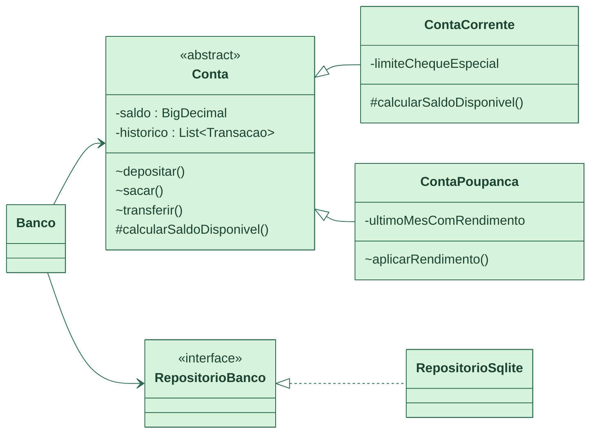

[English](README.md) · **Português**

[](https://github.com/Amandadamata/sistema-bancario-java/actions/workflows/ci.yml)


[](LICENSE)

Sistema bancário de linha de comando em Java 17, com conta corrente e poupança e dados em SQLite.

## O problema

A conta corrente pode ficar negativa até um limite. A poupança não pode, mas rende, e só uma vez por mês. Uma transferência precisa falhar sem deixar nenhuma das duas contas pela metade quando falta dinheiro. As contas também precisam ser exatas, e em Java `0.1 + 0.2` com `double` dá `0.30000000000000004`.

## A solução

Este sistema modela essas regras em Java puro. Pelo menu no terminal, você abre contas, deposita, saca, transfere e consulta o extrato. Os valores usam `BigDecimal`, então cada centavo é exato. Cada operação é salva num arquivo SQLite em uma única transação SQL: ou tudo é gravado, ou nada é, e a conta em memória volta a ser como era.

## Demonstração


*A conta 1000 é uma conta corrente com R$ 200 de cheque especial. Ela recebe R$ 100 e depois paga R$ 250 usando o limite. Um novo saque de R$ 100 é recusado, porque só restam R$ 50. A transferência de R$ 50 passa, e o extrato mostra cada movimentação com o saldo depois dela.*

## Funcionalidades

- Conta corrente com limite de cheque especial e conta poupança.
- Depósito, saque e transferência entre contas.
- Rendimento mensal de 0,5% na poupança, aplicado no máximo uma vez por mês.
- Extrato com tipo, valor com sinal, saldo resultante, data e a outra conta envolvida na transferência.
- Validação dos dígitos verificadores do CPF, com um CPF por titular.
- Dados salvos em SQLite, então contas e extratos continuam lá depois de fechar o programa.
- Formato brasileiro: dá para digitar `100,50` ou `100.50`, e o valor aparece como `R$ 1.234,56`.

## O que este projeto mostra

| Habilidade | Onde e como aparece |
|---|---|
| Abstração | `Conta` é uma classe `abstract` que guarda o saldo, o extrato e as regras comuns. `RepositorioBanco` é uma interface, então o `Banco` nem sabe que o SQLite existe. |
| Herança | `ContaCorrente` e `ContaPoupanca` estendem `Conta`. A poupança acrescenta `aplicarRendimento()`, que lembra o último mês em que rendeu. |
| Polimorfismo | `ContaCorrente` sobrescreve `calcularSaldoDisponivel()` para somar o cheque especial. `Conta` confere o saldo disponível sem perguntar que tipo de conta ela é. |
| Encapsulamento | Não existe `setSaldo`. O saldo só muda por operações que também escrevem uma linha no extrato, e `getHistorico()` devolve uma cópia com `List.copyOf`. |
| Exceções personalizadas | `SaldoInsuficienteException` é lançada pela `Conta` quando um saque ou transferência passa do saldo disponível. `FalhaPersistenciaException` avisa que a gravação falhou. |
| SQL e transações | O `RepositorioSqlite` desliga o auto-commit, grava todas as contas envolvidas e depois chama `commit()` ou `rollback()`. As consultas usam `PreparedStatement`, e as chaves estrangeiras ficam ativadas. |
| Testes parametrizados | 13 métodos com `@ParameterizedTest`. Por exemplo, o `ContaTest` envia `0`, `-10.00`, `0.001`, `10.005` e `null` para cada operação e confere que todos são recusados sem mudar nenhum saldo. |
| Testes automatizados e CI | 135 testes JUnit 6 em 9 classes, incluindo testes de integração com um arquivo SQLite real. O [`ci.yml`](.github/workflows/ci.yml) roda tudo no Java 17, 21 e 25 a cada push e pull request. |

## Como funciona



O `Main` só mostra o menu e lê o que você digita. Toda ação passa pelo `Banco`, que segue sempre os mesmos três passos. Primeiro, ele tira uma "foto" das contas envolvidas. Depois, pede para a conta aplicar a regra: a `Conta` confere o valor, pergunta ao `calcularSaldoDisponivel()` quanto pode ser gasto e lança `SaldoInsuficienteException` se não for suficiente. Por último, salva tudo numa transação SQL e, se a gravação falhar, as contas voltam para a foto. Quando o programa abre, ele refaz cada extrato e confere se a soma bate com o saldo gravado.

## Decisões técnicas

- **Escolhi `BigDecimal` em vez de `double`** porque o `double` não consegue guardar a maioria dos valores decimais de forma exata. No banco, o dinheiro fica em centavos inteiros (`INTEGER`) pelo mesmo motivo.
- **Escolhi o SQLite em vez de um servidor de banco** porque ele é um arquivo só, com SQL e transações de verdade, e não exige instalar nada a mais para rodar o projeto.
- **Escolhi fazer o cheque especial com sobrescrita de método em vez de um `if` pelo tipo da conta.** Um novo tipo de conta vira uma nova classe, sem mexer nas regras da `Conta`.
- **Escolhi uma exceção verificada (checked) para saldo insuficiente** porque é uma situação esperada, e o compilador obriga o menu a tratá-la com uma mensagem clara.

Mais detalhes e as alternativas que considerei estão em [DESIGN_DECISIONS.md](docs/DESIGN_DECISIONS.md) (em inglês).

## Como rodar

Você precisa do Java 17 ou mais novo. O primeiro build baixa o Maven e as dependências pelo Maven Wrapper. Desenvolvi no IntelliJ IDEA, mas qualquer terminal funciona.

```bash
git clone https://github.com/Amandadamata/sistema-bancario-java.git
cd sistema-bancario-java
./mvnw clean package
java -jar target/sistema-bancario-java-1.1.0.jar
```

```bash
./mvnw test
```

No Windows, use `mvnw.cmd`. Os dados ficam em `dados/sistema-bancario.db`. Para usar outro arquivo, defina `SISTEMA_BANCARIO_DB=/tmp/banco-demo.db`. O GIF da demonstração pode ser gravado de novo com o [VHS](https://github.com/charmbracelet/vhs): `vhs docs/assets/demo.tape`.

## Estrutura do projeto

```text
src/main/java/com/github/amandadamata/sistemabancario/
├── Banco.java                  # porta de entrada de toda operação; foto, aplica, salva ou desfaz
├── Conta.java                  # conta abstrata: saldo, extrato, regras comuns
├── ContaCorrente.java          # cheque especial
├── ContaPoupanca.java          # rendimento mensal
├── Cliente.java, Cpf.java      # titular e validação de CPF
├── Moeda.java, Transacao.java  # leitura e formatação de valores, linhas do extrato
├── RepositorioBanco.java       # contrato de armazenamento
├── persistencia/RepositorioSqlite.java  # JDBC + transações SQL
└── Main.java                   # só o menu do console
src/test/                       # 135 testes: unidade, integração com SQLite e sessões do menu
docs/                           # arquitetura, decisões, testes
```

## Limites e próximos passos

O que ainda não faz:

- A validação do CPF é só matemática. Ela não comprova a identidade de ninguém.
- O rendimento de 0,5% é uma regra simplificada, não a fórmula oficial da poupança.
- Não há login, juros de cheque especial nem encerramento de conta. Um processo por vez usa o banco, e o arquivo não é criptografado.

Próximos passos que estou planejando:

- Expor as contas por uma API REST com Spring Boot, que estou estudando agora.
- Encerramento de conta, com regras para o saldo que sobrar.
- Migrações de esquema (a versão já fica guardada em `PRAGMA user_version`).

## Autora

**Amanda da Mata** · Desenvolvedora Back-End em formação · Java e Python  
[LinkedIn](https://www.linkedin.com/in/amanda-da-mata-492106288) · [amandadamataprofissional@gmail.com](mailto:amandadamataprofissional@gmail.com) · [GitHub](https://github.com/Amandadamata)
