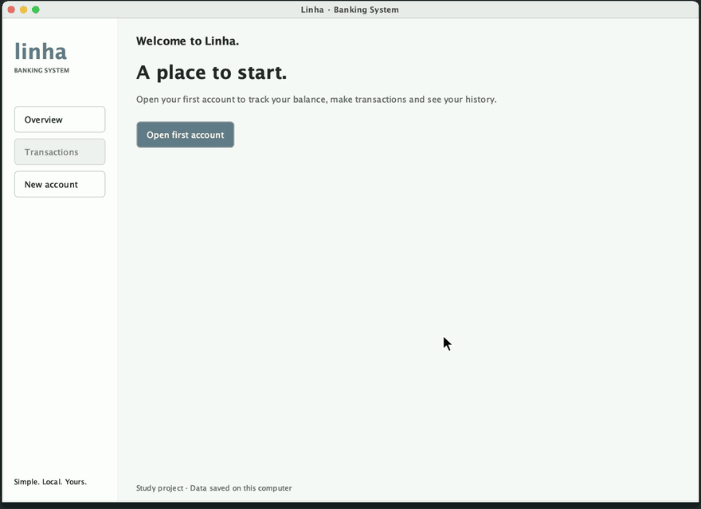
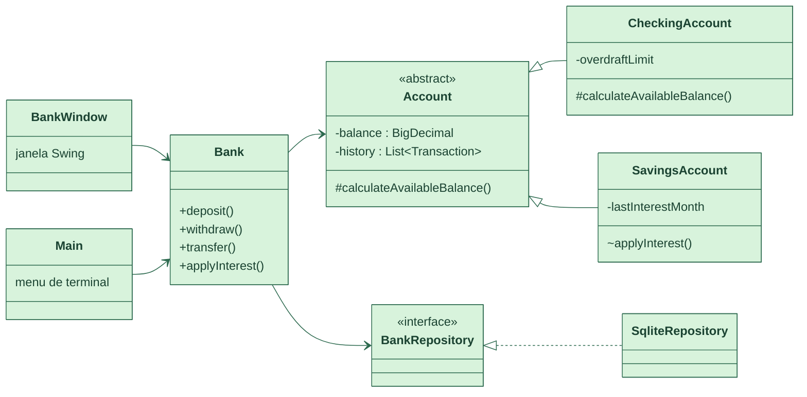

[English](README.md) · **Português**

[](https://github.com/Amandadamata/sistema-bancario-java/actions/workflows/ci.yml)


[](LICENSE)

Sistema bancário em Java 17, com conta corrente e poupança e dados em SQLite. Tem duas interfaces sobre as mesmas regras de negócio: o **Linha**, aplicativo desktop em Swing, e o menu original de terminal.

É um projeto de estudo. As operações alteram apenas saldos locais, e nenhum dinheiro real é movimentado. O aplicativo em si está em inglês.

## O problema

A conta corrente pode ficar negativa até um limite. A poupança não pode, mas rende, e só uma vez por mês. Uma transferência precisa falhar sem deixar nenhuma das duas contas pela metade quando falta dinheiro. A conta também tem que ser exata, e em Java `0.1 + 0.2` com `double` dá `0.30000000000000004`.

## A solução

Este sistema modela essas regras em Java puro. Você abre contas, deposita, saca, transfere e consulta o extrato, na janela ou no terminal. Os valores usam `BigDecimal`, então cada centavo é exato. Cada operação é gravada em um arquivo SQLite em uma única transação SQL: ou tudo é salvo, ou nada é, e a conta na memória volta a como estava.

A interface desktop entrou sem alterar nenhuma das classes originais de domínio, persistência ou menu. As duas interfaces chamam `Bank`, e nenhuma classe financeira importa Swing.

## Demonstração

### Interface desktop



*A janela, os cliques e os dados são reais, em um arquivo SQLite temporário. Os quadros são pintados pelos próprios componentes Swing; a barra de título, o ponteiro e as legendas são desenhados pelo [script de gravação](scripts/demo/RecordInterfaceDemo.java).*

### Terminal


*A conta 1000 tem limite de R$ 200 no cheque especial. Ela recebe R$ 100 e paga R$ 250 usando o limite. Um novo saque de R$ 100 é recusado, porque só restam R$ 50. Depois de fechar e abrir de novo, os saldos continuam lá.*

## Funcionalidades

- Conta corrente com limite de cheque especial e conta poupança.
- Depósitos, saques e transferências entre contas.
- Rendimento mensal de 0,5% na poupança, no máximo uma vez por mês.
- Extrato com data, tipo, valor com sinal, saldo resultante e a outra conta da transferência.
- Validação dos dígitos verificadores do CPF, com um CPF por titular.
- Dados salvos em SQLite: contas e extratos sobrevivem ao reinício.
- Valores em reais: você digita `100.50` ou `100,50` e vê `R$ 1.234,56`.
- No desktop: erros preservam o formulário, a gravação roda em segundo plano para a janela não travar, e um duplo clique não envia duas vezes.

## O que este projeto mostra

| Habilidade | Onde / como aparece |
|---|---|
| Abstração | `Account` é uma classe `abstract` com o saldo, o extrato e as regras comuns. `BankRepository` é uma interface, então `Bank` nem sabe que o SQLite existe. |
| Herança | `CheckingAccount` e `SavingsAccount` estendem `Account`. A poupança acrescenta `applyInterest()`, que lembra o último mês em que rendeu. |
| Polimorfismo | `CheckingAccount` sobrescreve `calculateAvailableBalance()` para somar o limite. `Account` confere o disponível sem perguntar qual é o tipo da conta. |
| Encapsulamento | Não existe `setBalance`. O saldo só muda por operações que também escrevem no extrato, e `getHistory()` devolve uma cópia com `List.copyOf`. |
| Camadas separadas | Duas interfaces dividem um único domínio. O pacote `ui` só chega às contas por meio de `Bank`, e o desktop foi adicionado sem editar nenhuma regra financeira. |
| Concorrência em GUI | `UiTasks` executa cada gravação em um `SwingWorker`, fora da thread de eventos, uma de cada vez. Os controles ficam desabilitados e fechar a janela espera o término. |
| Exceções próprias | `Account` lança `InsufficientFundsException` quando um saque ou transferência passa do disponível. `PersistenceFailureException` informa uma gravação que falhou. |
| SQL e transações | `SqliteRepository` desliga o auto-commit, grava todas as contas envolvidas e chama `commit()` ou `rollback()`. As consultas usam `PreparedStatement`, e as chaves estrangeiras estão ligadas. |
| Testes parametrizados | 13 métodos `@ParameterizedTest`. Por exemplo, `AccountTest` envia `0`, `-10.00`, `0.001`, `10.005` e `null` a cada operação e confere que todos são recusados e nenhum saldo muda. |
| Testes automatizados e CI | 153 testes em JUnit 6 e 13 classes, com arquivo SQLite real e janelas Swing reais. O [`ci.yml`](.github/workflows/ci.yml) os executa em Java 17, 21 e 25 (os fluxos Swing no 17, em tela virtual) e roda o JAR empacotado. |

## Como funciona



Toda ação passa por `Bank`, que segue sempre os mesmos três passos. Primeiro, tira uma foto das contas envolvidas. Depois, pede à conta que aplique a regra: `Account` confere o valor, pergunta a `calculateAvailableBalance()` quanto pode ser gasto e lança `InsufficientFundsException` se não der. Por último, grava tudo em uma transação SQL e, se a gravação falhar, as contas voltam à foto. Ao iniciar, o sistema refaz cada extrato e confere se ele bate com o saldo gravado.

Mais em [ARCHITECTURE.md](docs/ARCHITECTURE.md).

## Decisões técnicas

- **Escolhi `BigDecimal` em vez de `double`** porque `double` não guarda a maioria dos decimais com exatidão. No banco, o dinheiro fica em centavos inteiros (`INTEGER`) pelo mesmo motivo.
- **Escolhi SQLite em vez de um servidor de banco de dados** porque é um único arquivo, com SQL e transações de verdade, e nada a mais para instalar.
- **Escolhi fazer o cheque especial como sobrescrita, e não como um `if` no tipo da conta.** Um novo tipo de conta significa uma nova classe, sem editar as regras de `Account`.
- **Escolhi uma exceção verificada para saldo insuficiente** porque é uma situação esperada, e o compilador obriga cada interface a tratá-la com uma mensagem clara.
- **Escolhi Swing com FlatLaf em vez de um front-end web** porque vai em um único JAR com as classes Java existentes, sem servidor nem navegador.

Mais detalhes e as alternativas que considerei estão em [DESIGN_DECISIONS.md](docs/DESIGN_DECISIONS.md).

## Como executar

### Baixar pronto

| Pacote | O que precisa | Como abrir |
|---|---|---|
| [`Linha-portable-JAR.zip`](https://github.com/Amandadamata/sistema-bancario-java/releases/latest/download/Linha-portable-JAR.zip) | Java 17 ou superior, em qualquer sistema | `java -jar Linha.jar` para a janela, ou `java -jar Linha.jar --terminal` para o menu |
| [`Linha-Mac-AppleSilicon.zip`](https://github.com/Amandadamata/sistema-bancario-java/releases/latest/download/Linha-Mac-AppleSilicon.zip) | Mac com Apple Silicon; o Java já vem incluído | Descompacte e abra o `Linha.app` |

O aplicativo para Mac não tem certificado de desenvolvedor Apple, então o macOS bloqueia a primeira abertura. Para liberar, tente abrir uma vez e depois vá em **Ajustes do Sistema → Privacidade e Segurança → Abrir Mesmo Assim**.

### Pelo código-fonte

Você precisa de Java 17 ou superior. O primeiro build baixa o Maven e as dependências pelo Maven Wrapper.

```bash
git clone https://github.com/Amandadamata/sistema-bancario-java.git
cd sistema-bancario-java
./mvnw clean package
```

Abrir o aplicativo desktop:

```bash
java -jar target/linha-banking-system-1.4.0.jar
```

Abrir o menu no terminal:

```bash
java -jar target/linha-banking-system-1.4.0.jar --terminal
```

No Windows, use `mvnw.cmd`. No IntelliJ IDEA, abra o `pom.xml`, escolha um JDK 17 ou superior e execute `DesktopMain` (janela) ou `Main` (terminal).

Para explorar, use dados inventados. Este CPF sintético passa na validação: `246.813.579-28`.

### Onde ficam os dados

| Interface | Arquivo padrão |
|---|---|
| Desktop no macOS | `~/Library/Application Support/Linha/linha.db` |
| Desktop em outros sistemas | `~/.linha/linha.db` |
| Terminal | `data/linha.db`, relativo à pasta atual |

Para usar outro arquivo, defina `LINHA_DB=/tmp/bank-demo.db`. Arquivos da versão 1.3 ou anterior (`sistema-bancario.db`, com tabelas em português) continuam abrindo: o aplicativo os atualiza para o esquema atual na primeira vez, em uma única transação. O arquivo `.db.lock` ao lado do banco impede que uma segunda janela abra os mesmos dados, e é normal que ele continue lá depois de fechar.

### Testes

```bash
./mvnw test                # domínio, SQLite e apresentação; ignora os 8 fluxos Swing
./mvnw -Pui-tests verify   # os 153 testes; requer sessão gráfica
```

No Linux sem tela: `xvfb-run -a ./mvnw -Pui-tests verify`. Mais em [TESTING.md](docs/TESTING.md).

### Empacotamento e demonstrações

- `./scripts/package-macos.sh` gera o `Linha.app` com `jpackage` e os dois ZIPs, em um Mac.
- `vhs docs/assets/demo.tape` grava a demonstração do terminal, com o [VHS](https://github.com/charmbracelet/vhs).
- [`RecordInterfaceDemo.java`](scripts/demo/RecordInterfaceDemo.java) grava a demonstração desktop.

## Estrutura do projeto

```text
src/main/java/com/github/amandadamata/bankingsystem/
├── DesktopMain.java                    # entrada do JAR: abre a janela ou, com --terminal, o menu
├── AppDataFile.java                    # caminho estável dos dados e trava entre instâncias desktop
├── Bank.java                           # porta de entrada de toda operação; foto, aplica, salva ou desfaz
├── Account.java                        # conta abstrata: saldo, extrato, regras comuns
├── CheckingAccount.java                # cheque especial
├── SavingsAccount.java                 # rendimento mensal
├── Customer.java, Cpf.java             # titular e validação de CPF
├── Money.java, Transaction.java        # leitura e formatação de valores, linhas do extrato
├── BankRepository.java                 # contrato de armazenamento
├── persistence/SqliteRepository.java   # JDBC + transações SQL
├── ui/                                 # janela, telas, tema e tarefas em segundo plano
└── Main.java                           # só o menu do console
src/test/                               # 153 testes: unidade, integração com SQLite, menu e fluxos Swing
scripts/                                # empacotamento macOS e gravação das demonstrações
docs/                                   # arquitetura, decisões, testes, notas da evolução
```

## Limites e próximos passos

O que ainda não faz:

- A validação do CPF é só matemática. Ela não comprova a identidade de ninguém.
- O rendimento de 0,5% é uma regra simplificada, não a fórmula oficial da poupança.
- Não há login, juros de cheque especial nem encerramento de conta, e o arquivo não é criptografado. Escolher uma conta na janela é navegação, não controle de acesso.
- A trava de arquivo vale só entre instâncias desktop. Não use o terminal e a janela no mesmo arquivo ao mesmo tempo.
- Contas e extratos ficam carregados na memória, o que serve para poucos dados locais.

Próximos passos que estou planejando:

- Expor as contas por uma API REST com Spring Boot, com os mesmos padrões da minha [Ticket Booking API](https://github.com/Amandadamata/ticket-booking-api) (updates atômicos em SQL, pedidos idempotentes e erros no padrão RFC 9457).
- Encerramento de conta, com regras para o saldo que sobrar.
- Exportação do extrato e paginação para históricos maiores.

## Autora

**Amanda da Mata** · Desenvolvedora Back-End em formação · Java e Python  
[LinkedIn](https://www.linkedin.com/in/amanda-da-mata-492106288) · [amandadamataprofissional@gmail.com](mailto:amandadamataprofissional@gmail.com) · [GitHub](https://github.com/Amandadamata)

Licença [MIT](LICENSE). O tema desktop usa [FlatLaf](https://www.formdev.com/flatlaf/), sob a licença Apache 2.0.
