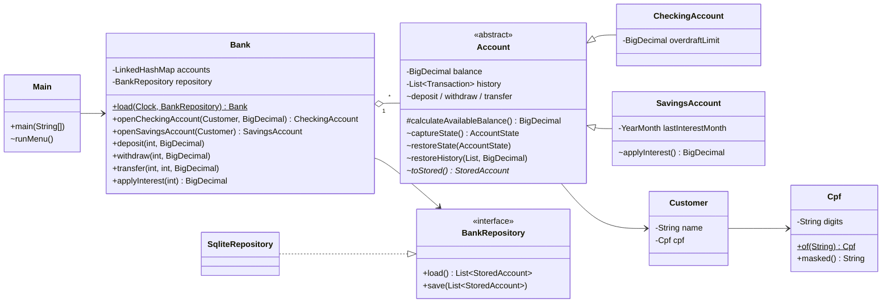
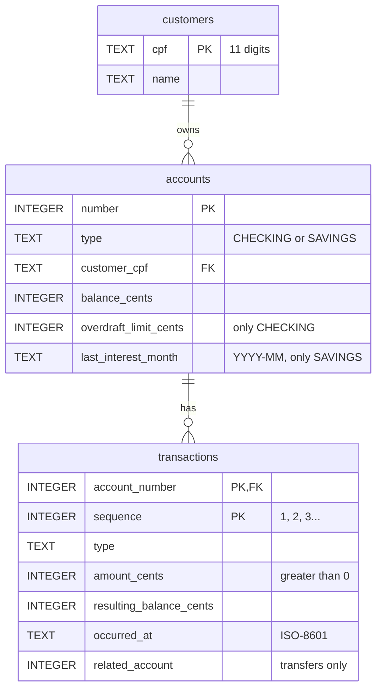
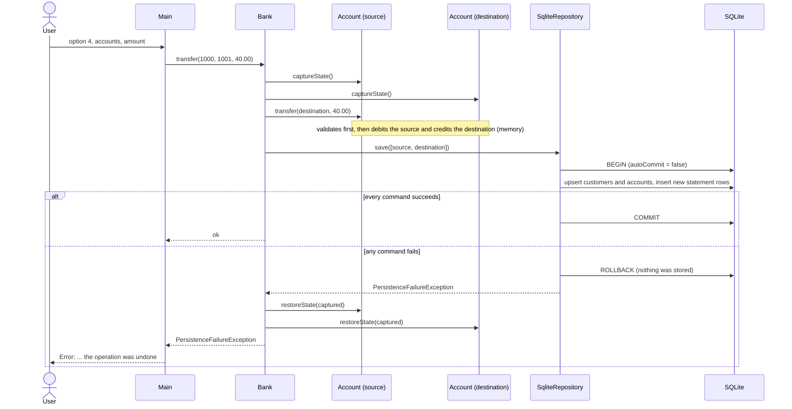

# Architecture

This document describes how the banking system is organized, how an operation moves through it,
and how data is stored. For the reasons behind each choice, see
[DESIGN_DECISIONS.md](DESIGN_DECISIONS.md).

## Overview

| Layer | Classes | Knows about |
|---|---|---|
| Desktop interface | `DesktopMain`, `ui.BankWindow`, panels, `UiTasks` | `Bank`, Swing, FlatLaf |
| Console interface | `Main` | `Bank`, domain types for display |
| Domain | `Bank`, `Account`, `CheckingAccount`, `SavingsAccount`, `Customer`, `Cpf`, `Transaction`, `TransactionType`, `Money`, exceptions | Only the `BankRepository` interface |
| Storage contract | `BankRepository`, `StoredAccount`, `AccountType` | Domain value types |
| Persistence | `persistence.SqliteRepository` | JDBC, SQLite, the storage contract |

The domain never imports JDBC or SQLite classes. Dependencies point inward: the persistence package
implements an interface that the domain defines.

## Class diagram

`~` marks package-private members: operations that change balances can only be called by `Bank`,
which is in the same package. `Main` is also in that package, so package visibility alone cannot prevent it from calling those methods. By convention it calls `Bank`; the new `ui` subpackage is outside that boundary and cannot call the package-private account mutations.

## Database schema

- Money columns hold **integer cents** (`R$ 10,50` → `1050`).
- `CHECK` constraints reject an empty name, a CPF that is not 11 characters long, an unknown account
  type, a non-positive amount, and a limit on a savings account.
- Foreign keys are enabled on every connection (`PRAGMA foreign_keys = ON`; SQLite leaves them off by
  default).
- The schema version is stored in `PRAGMA user_version` (currently `2`). Version 1 used Portuguese
  table, column and value names; opening a version 1 file copies its data into the current tables
  and drops the old ones, all in one transaction.

## Opening the program

1. `Main.main` resolves the data file: `LINHA_DB` or `data/linha.db` (an existing
   `dados/sistema-bancario.db` from version 1.3 or earlier is kept).
2. `new SqliteRepository(file)` creates the folder if needed, opens the file, and checks the schema
   version: `0` (new file) → create tables; `1` → migrate to the current schema; `2` → ready; newer →
   refuse without changes.
3. `Bank.load(clock, repository)` reads every account and rebuilds it:
   - creates the `Customer`, which validates the CPF again;
   - replays the statement from zero: each entry must produce exactly the balance stored in it, and
     the last one must match the account balance;
   - restores the last yield month of savings accounts;
   - sets the next account number to the highest number plus one.
4. Any problem raises `PersistenceFailureException`; `Main` prints the reason and does not start.

## An operation, step by step: a transfer

If the business rule refuses the operation (for example, insufficient funds), the exception happens
before anything changes and nothing is saved.

## Error handling

| Situation | Exception | Where it is handled |
|---|---|---|
| Not enough available balance | `InsufficientFundsException` (checked) | `Main` prints the message |
| Invalid amount, destination, or account type | `IllegalArgumentException` | `Main` prints the message |
| Yield already applied this month | `IllegalStateException` | `Main` prints the message |
| Invalid CPF typed by the user | `IllegalArgumentException` from `Cpf.of` | `Main.readCpf` asks again |
| CPF already used by another holder | `IllegalArgumentException` | `Main` prints the message |
| Saving fails | `PersistenceFailureException` | `Bank` undoes the change; `Main` prints the message |
| Unreadable, inconsistent, or newer database at startup | `PersistenceFailureException` | `Main.main` prints it and exits |
| End of input | `NoSuchElementException` | `Main` ends the session |

## Time

`Bank` receives a `java.time.Clock` and passes it to every account. Statement timestamps and the
"once per month" yield rule read the time from that clock; tests use a clock they control.

## Desktop entry point (1.2.0)

The executable JAR starts `DesktopMain`. With `--terminal`, it hands over to the original `Main`
menu instead; running through `java -jar` also avoids the native-access warning on recent JDKs.
`DesktopMain` resolves a stable user data path, acquires a file lock, loads the unchanged SQLite
schema and schedules window construction on the EDT. `BankWindow` swaps panels inside one window.
Forms capture immutable request data on the EDT. `UiTasks` runs one `Bank` operation at a time
through `SwingWorker`, then refreshes the view or shows an error on the EDT. Controls stay disabled
and window closing waits during a write. The domain itself remains single-threaded.

`HistoryTableModel` copies existing transactions, reverses their presentation order and formats
them for a read-only table. `ScrollablePanel` tracks viewport width when resizing.

The default macOS desktop path is `~/Library/Application Support/Linha/linha.db`.
`LINHA_DB` overrides it, and the old `SISTEMA_BANCARIO_DB` name still works. When only the
file from version 1.3 or earlier exists, the app keeps using it instead of starting empty. The file lock coordinates desktop instances
only; do not use the CLI or external editors concurrently on that file.
