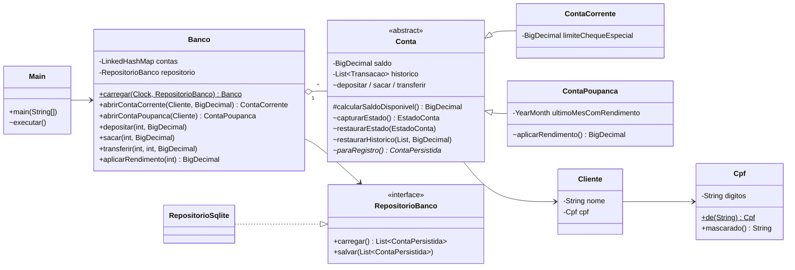
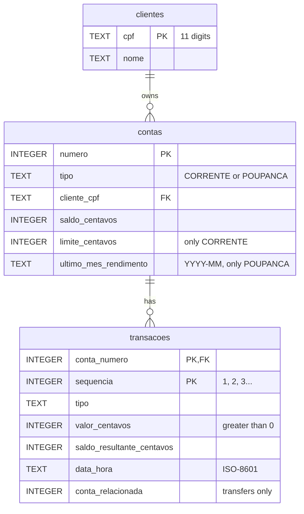

# Architecture

This document describes how the banking system is organized, how an operation moves through it,
and how data is stored. For the reasons behind each choice, see
[DESIGN_DECISIONS.md](DESIGN_DECISIONS.md).

## Overview

| Layer | Classes | Knows about |
|---|---|---|
| Console interface | `Main` | `Banco`, domain types for display |
| Domain | `Banco`, `Conta`, `ContaCorrente`, `ContaPoupanca`, `Cliente`, `Cpf`, `Transacao`, `TipoTransacao`, `Moeda`, exceptions | Only the `RepositorioBanco` interface |
| Storage contract | `RepositorioBanco`, `ContaPersistida`, `TipoConta` | Domain value types |
| Persistence | `persistencia.RepositorioSqlite` | JDBC, SQLite, the storage contract |

The domain never imports JDBC or SQLite classes. Dependencies point inward: the persistence package
implements an interface that the domain defines.

## Class diagram



`~` marks package-private members: operations that change balances can only be called by `Banco`,
which is in the same package. `Main` cannot call `conta.depositar(...)` directly and bypass saving.

## Database schema



- Money columns hold **integer cents** (`R$ 10,50` → `1050`).
- `CHECK` constraints reject an empty name, a CPF that is not 11 characters long, an unknown account
  type, a non-positive amount, and a limit on a savings account.
- Foreign keys are enabled on every connection (`PRAGMA foreign_keys = ON`; SQLite leaves them off by
  default).
- The schema version is stored in `PRAGMA user_version` (currently `1`).

## Opening the program

1. `Main.main` resolves the data file: `SISTEMA_BANCARIO_DB` or `dados/sistema-bancario.db`.
2. `new RepositorioSqlite(file)` creates the folder if needed, opens the file, and checks the schema
   version: `0` (new file) → create tables; `1` → ready; newer → refuse without changes.
3. `Banco.carregar(clock, repository)` reads every account and rebuilds it:
   - creates the `Cliente`, which validates the CPF again;
   - replays the statement from zero: each entry must produce exactly the balance stored in it, and
     the last one must match the account balance;
   - restores the last yield month of savings accounts;
   - sets the next account number to the highest number plus one.
4. Any problem raises `FalhaPersistenciaException`; `Main` prints the reason and does not start.

## An operation, step by step: a transfer

```mermaid
sequenceDiagram
    actor User
    participant Main
    participant Banco
    participant Origem as Conta (origin)
    participant Destino as Conta (destination)
    participant Repo as RepositorioSqlite
    participant DB as SQLite

    User->>Main: option 4, accounts, amount
    Main->>Banco: transferir(1000, 1001, 40.00)
    Banco->>Origem: capturarEstado()
    Banco->>Destino: capturarEstado()
    Banco->>Origem: transferir(destino, 40.00)
    Note over Origem,Destino: validates first; debits origin, credits destination (memory)
    Banco->>Repo: salvar([origin, destination])
    Repo->>DB: BEGIN (autoCommit = false)
    Repo->>DB: upsert customers, accounts; insert new statement rows
    alt every command succeeds
        Repo->>DB: COMMIT
        Banco-->>Main: ok
    else any command fails
        Repo->>DB: ROLLBACK (nothing was stored)
        Repo-->>Banco: FalhaPersistenciaException
        Banco->>Origem: restaurarEstado(captured)
        Banco->>Destino: restaurarEstado(captured)
        Banco-->>Main: FalhaPersistenciaException
        Main-->>User: Erro: ... a operação foi desfeita
    end
```

If the business rule refuses the operation (for example, insufficient funds), the exception happens
before anything changes and nothing is saved.

## Error handling

| Situation | Exception | Where it is handled |
|---|---|---|
| Not enough available balance | `SaldoInsuficienteException` (checked) | `Main` prints the message |
| Invalid amount, destination, or account type | `IllegalArgumentException` | `Main` prints the message |
| Yield already applied this month | `IllegalStateException` | `Main` prints the message |
| Invalid CPF typed by the user | `IllegalArgumentException` from `Cpf.de` | `Main.lerCpf` asks again |
| CPF already used by another holder | `IllegalArgumentException` | `Main` prints the message |
| Saving fails | `FalhaPersistenciaException` | `Banco` undoes the change; `Main` prints the message |
| Unreadable, inconsistent, or newer database at startup | `FalhaPersistenciaException` | `Main.main` prints it and exits |
| End of input | `NoSuchElementException` | `Main` ends the session |

## Time

`Banco` receives a `java.time.Clock` and passes it to every account. Statement timestamps and the
"once per month" yield rule read the time from that clock; tests use a clock they control.
