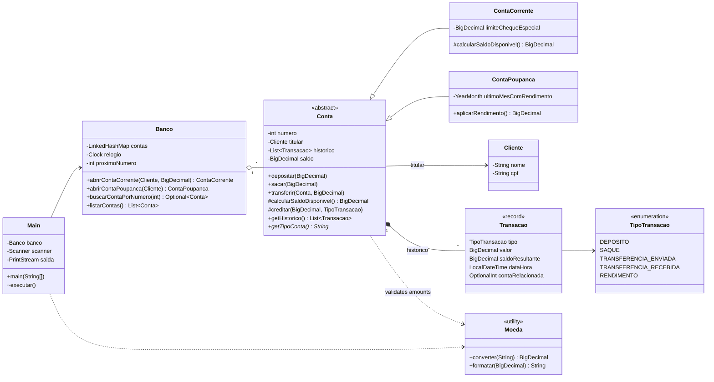
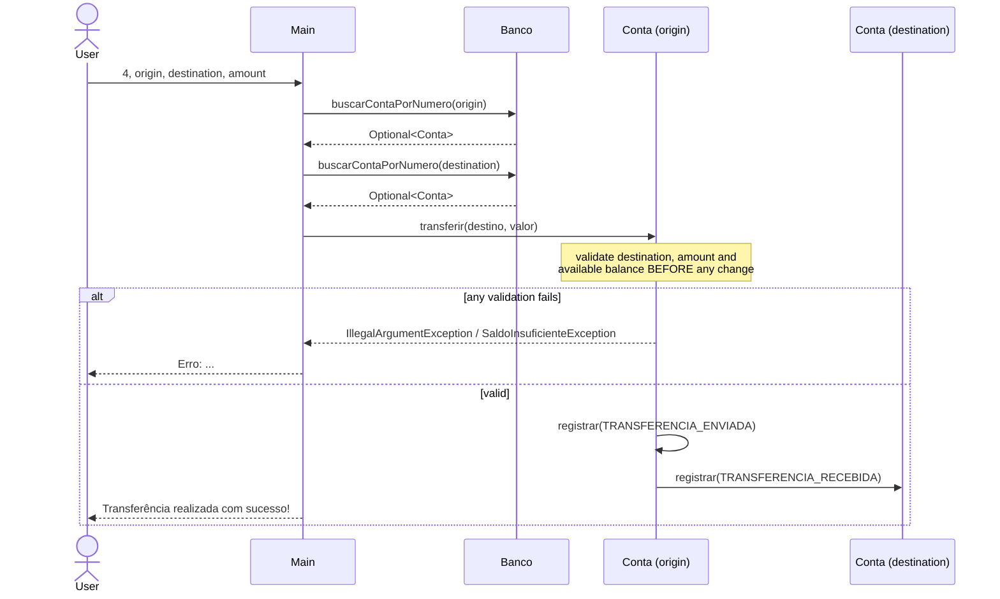

# Architecture

This document describes how the banking system is organized and how a request moves through it.
For the reasons behind each choice, see [DESIGN_DECISIONS.md](DESIGN_DECISIONS.md).

## Overview

The application has two layers inside a single package:

- **Domain** (`Banco`, `Conta`, `ContaCorrente`, `ContaPoupanca`, `Cliente`, `Transacao`,
  `TipoTransacao`, `Moeda`, `SaldoInsuficienteException`): business rules and state. No class in
  this layer reads from the keyboard or prints to the screen.
- **Console interface** (`Main`): reads input, calls the domain, and formats results.

There is no persistence layer; all data lives in memory for the duration of one run.

## Class diagram

## Responsibilities

| Class | Owns | Does not do |
|---|---|---|
| `Banco` | The set of accounts and the next account number | Money operations |
| `Conta` | Balance, history, and the rules shared by every account | Decide how much can be spent (asks `calcularSaldoDisponivel()`) |
| `ContaCorrente` | The overdraft limit | Anything else; it only changes the available balance |
| `ContaPoupanca` | The month in which yield was last applied | Withdrawals or transfers (inherited unchanged) |
| `Transacao` | One immutable statement line | Changing balances |
| `Moeda` | Parsing, validating, rounding, and formatting money | Business decisions |
| `Main` | Menu loop, prompts, and output formatting | Business rules |

## Execution flow

1. `Main.main` creates a `Banco` with the system clock and starts the menu with `System.in` and
   `System.out`.
2. The menu reads an option with `lerInteiro`. Invalid text is rejected and asked again.
3. Each option reads the values it needs. Money is read with `lerValor`, which uses
   `Moeda.converter` and repeats the prompt until the format is valid.
4. The option calls the domain. Business errors come back as exceptions and are printed as
   `Erro: <message>`; the menu continues.
5. Option `0` or the end of the input stream ends the loop.

### Transfer, step by step

## Error handling

| Situation | Exception | Type | Handled in |
|---|---|---|---|
| Not enough available balance | `SaldoInsuficienteException` | checked | `Main` prints the message |
| Zero, negative, null, or over-precise amount | `IllegalArgumentException` | unchecked | `Main` prints the message |
| Invalid destination (null or same account) | `IllegalArgumentException` | unchecked | `Main` prints the message |
| Yield already applied this month | `IllegalStateException` | unchecked | `Main` prints the message |
| Text that is not a number | none (parsing loop) | — | `Main` asks again |
| End of input | `NoSuchElementException` | unchecked | `Main` ends the session |

## Time

`Banco` receives a `java.time.Clock` and passes it to every account. Statement timestamps and the
"once per month" yield rule read the time from that clock, never from the system directly. In
production it is `Clock.systemDefaultZone()`; tests use a clock they can move forward.
